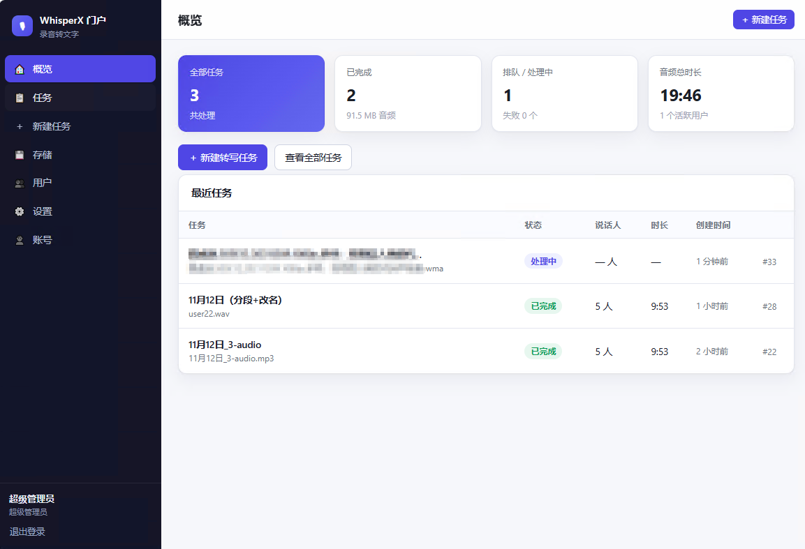
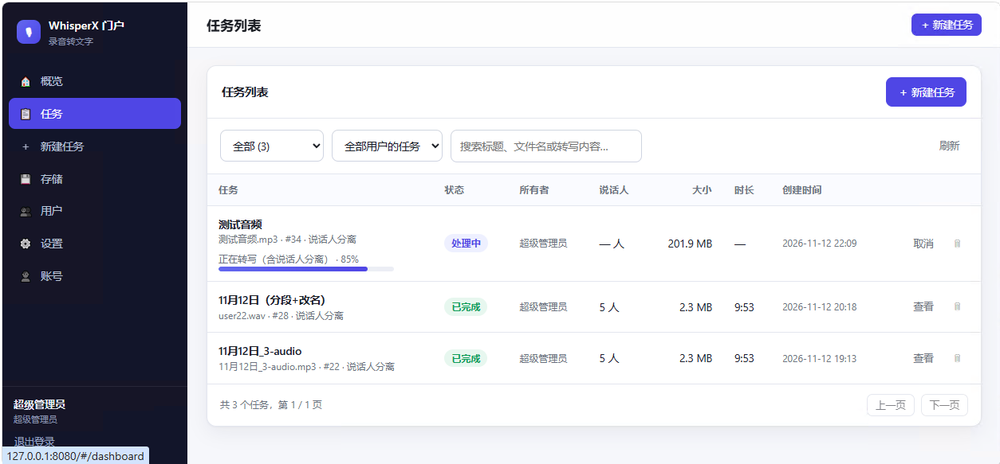
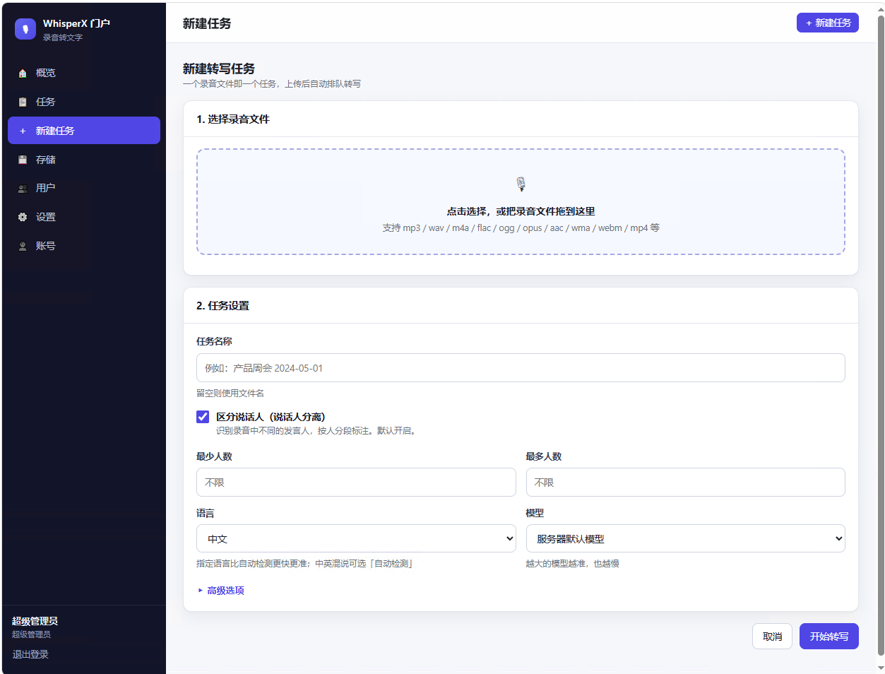
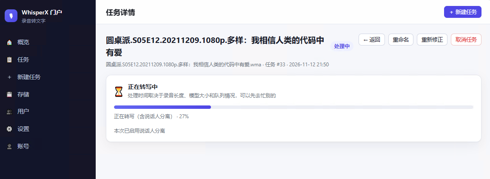
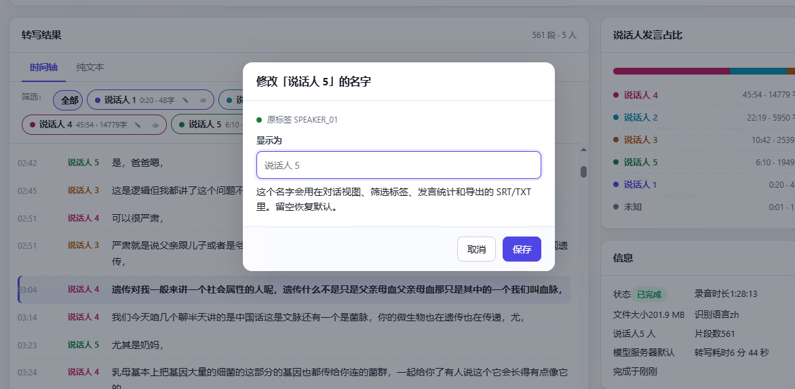
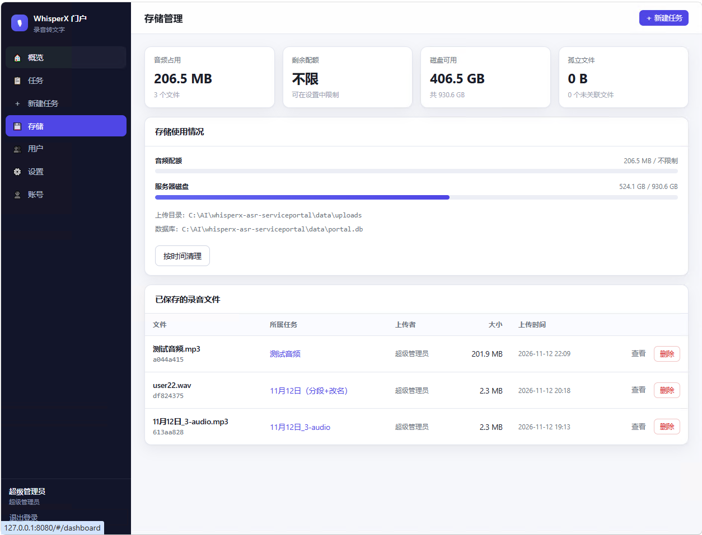
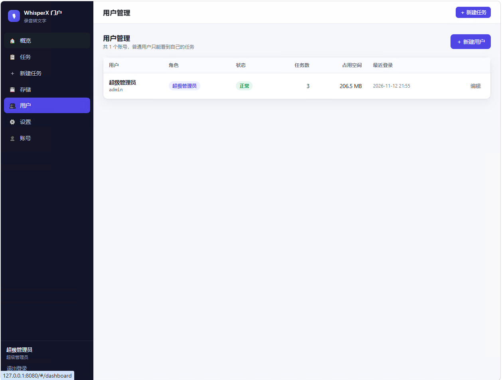
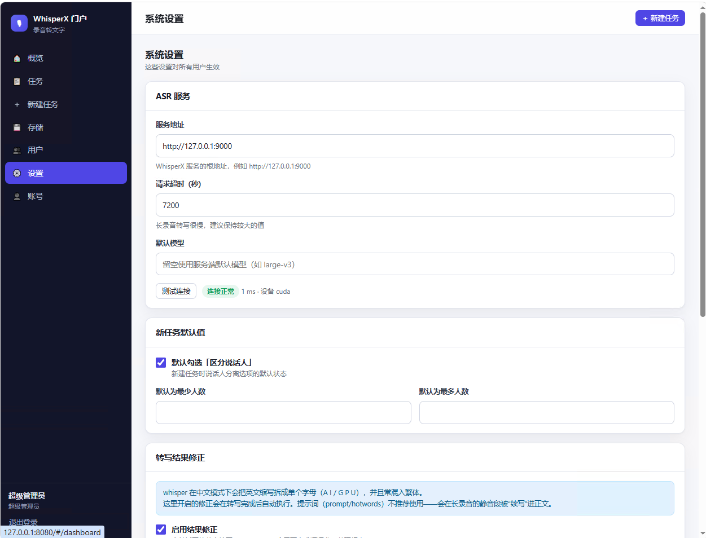

# WhisperX ASR 门户（录音转文字 Web 前端）

这是给 [whisperx-asr-service](https://github.com/murtaza-nasir/whisperx-asr-service)
配的 Web 门户：带账号体系、SQLite 数据库、任务管理、说话人分离和服务器端录音存储。

上游的 whisperx-asr-service 只提供裸 API（`POST /asr`），没有登录、没有任务管理、
没有前端。这个门户补上了这些，让你可以当日常工具来用：

- 多个用户各自登录，只能看到自己的录音
- 上传一个录音 = 一个任务，自动排队转写
- 自动区分录音里的不同说话人，并可给说话人改名
- 在页面上边听边看转写，随时跳到某一句
- 录音存在服务器上，可以按需清理

后端和前端都是 **TypeScript**；前端编译成原生 ES module，不需要任何前端框架或打包器。

```
浏览器 ──HTTP──> 门户 (Express + TS, :8080) ──/asr──> WhisperX ASR 服务 (:9000)
                       │
                       ├── SQLite (data/portal.db)   账号、任务、设置
                       └── data/uploads/<用户>/      录音文件
```

> **前置条件**：需要先跑起一个 whisperx-asr-service。没有 Docker 环境的话，
> 那个项目带了 `setup-native.bat` / `start-native.bat`，可以直接在 Windows 上
> 用 Python + CUDA 跑（不需要 Docker、不需要开虚拟化）。

> **给 AI 助手**：如果你要继续开发这个项目，先读 [AGENTS.md](AGENTS.md)，
> 里面有架构决策、已踩过的坑和已知未解决的问题。

## 快速开始

### 方式一：Docker Compose（推荐）

三个服务一起跑：ASR 转写（GPU）、标点恢复（CPU）、门户。

```bash
# 1. 填 HF_TOKEN（说话人分离必需）
cp .env.docker.example .env.docker
#    编辑 .env.docker，填入你的 HF_TOKEN

# 2. 启动
docker compose --env-file .env.docker up -d

# 3. 打开
#    http://127.0.0.1:8080
```

首次启动会拉镜像、下模型，约 10-20 分钟。之后 `docker compose up -d` 秒起。

```bash
docker compose logs -f portal     # 看门户日志
docker compose ps                 # 看服务状态
docker compose down               # 停止（数据保留在卷里）
```

| 服务 | 端口 | 说明 |
|------|------|------|
| `portal` | 8080 | 门户本体 |
| `asr` | 9000 | WhisperX 转写，需要 NVIDIA GPU |
| `punc` | 9001 | 中文标点恢复，CPU 即可 |

### 方式二：本地 Node 直跑（只跑门户）

如果 ASR 服务已经单独跑在别处，只想启动门户：

```bash
npm install
npm run build
npm start
```

然后打开 <http://127.0.0.1:8080>。

默认超级管理员：

| 用户名 | 密码 |
|--------|--------|
| `admin` | `admin123` |

> ⚠️ 首次登录后请立刻到「账号」页改密码，或在启动前用环境变量覆盖（见下）。

门户默认把任务发到 `http://127.0.0.1:9000`。如果 ASR 服务不在这个地址，登录后在
**设置 → ASR 服务 → 服务地址** 里改，或者用环境变量 `ASR_BASE_URL` 指定。


## 页面一览

| 页面 | 作用 |
|------|------|
| **概览** | 任务统计、累计时长、最近任务 |
| **任务** | 全部任务列表，可按状态筛选、搜索标题/文件名/转写内容 |
| **新建任务** | 拖拽上传录音，勾选说话人分离，选语言和模型 |
| **任务详情** | 顶部播放条（与文字联动）、说话人筛选、转写文本、导出 |
| **存储** | 音频占用、磁盘剩余、孤立文件清理、按时间清理 |
| **用户** | 管理账号、角色、禁用、重置密码（管理员） |
| **设置** | ASR 地址、默认模型、术语词典、存储配额（管理员） |
| **账号** | 改自己的密码 |

## 界面预览

### 概览

任务总数、累计音频时长、排队/失败情况，以及最近的任务。



### 任务列表

一个录音一个任务。可按状态筛选，搜索标题、文件名或转写内容。
处理中的任务直接在列表里显示进度条。



### 新建任务

拖拽上传，**「区分说话人」默认勾选**。可以指定最少/最多人数提高分离准确率，
也可以选语言和模型，填热词和提示词。



### 转写结果

这是主界面：

- **顶部播放条**与下方文字双向联动 —— 播放时自动高亮当前句并滚动跟随，
  点任意一句从那里开始播放；进度条可直接拖动，支持 ±10 秒
- **左侧**按说话人筛选，每个标签显示该人的发言时长和字数；
  点说话人名字可直接改名
- **右侧**是发言占比、任务信息和导出按钮
- 转写文本按停顿断句并补标点，长时间轴也能读



### 修改说话人名字

点标签里的 ✎ 或文字里的说话人名字，只改这一个人。
改完在对话视图、筛选标签、发言统计和导出的 SRT/TXT 里都会用新名字。



### 存储管理

音频占用、磁盘剩余、容量配额，以及没有被任何任务引用的「孤立文件」清理。



### 用户管理

管理员可以新建、编辑、禁用用户，重置密码，查看每人占用的空间。



### 系统设置

配置 ASR 服务地址和超时、新任务的默认值、存储配额，以及转写结果的修正规则
（术语词典、繁转简、停顿补标点）。



## 功能

**账号**
- 首次启动自动创建超级管理员
- 三种角色：超级管理员 / 管理员 / 普通用户
- 管理员可以创建、编辑、禁用、删除用户，重置密码
- Cookie 会话（HttpOnly + SameSite=Lax），scrypt 密码哈希
- 改密码后该用户其它设备的登录立即失效
- 删除用户会连带删除其任务和录音文件

**任务（一个录音 = 一个任务）**
- 拖拽或选择文件上传，支持 mp3 / wav / m4a / flac / ogg / opus / aac / wma / webm / mp4 等
- **创建时「区分说话人」默认勾选**，可选最少/最多人数；该默认值可在设置里改
- 可选语言、模型、任务类型（转写/翻译）、热词、提示词
- 后台队列串行调用 ASR（`WORKER_CONCURRENCY` 可调），页面实时显示进度
- 列表支持按状态筛选、关键词搜索（标题/文件名/转写内容）、分页
- 详情页：对话视图（按说话人合并段落）、时间轴（点击跳转播放）、纯文本、音频播放
- 导出 TXT / SRT / VTT / JSON；可下载原始录音
- 失败可「重新转写」，进行中可「取消」

**权限隔离**
- 普通用户只能看到、操作自己的任务和文件
- 管理员能看到所有人的任务，可按「只看我的」切换

**存储**
- 上传后文件保存在服务器 `data/uploads/<用户ID>/`
- 存储页显示音频占用、配额、磁盘剩余、孤立文件（上传中断残留）
- 可删除单个录音（保留文字）、按时间批量清理、清理孤立文件
- 可设容量上限，超限拒绝新上传

## 说话人分离（区分录音中的多人）

门户建任务时默认勾选「区分说话人」。这个功能由 ASR 服务端的 **pyannote** 模型完成，
需要先在 ASR 服务那侧配置 `HF_TOKEN`，否则任务会报 403。

**在 `C:\AI\whisperx-asr-service\.env` 里配置：**

```ini
HF_TOKEN=hf_你的令牌
RESEGMENT_BY_SPEAKER=true
```

- `HF_TOKEN`：在 <https://huggingface.co/settings/tokens> 生成（Read 权限），
  并接受三个 pyannote 模型的用户协议
- `RESEGMENT_BY_SPEAKER=true`：按说话人变化重新切分段落。
  **不开这个，多人对话容易被合并成一段、只标一个说话人。**

改完重启 ASR 服务（`start-native.bat`）即可。详细步骤见
[whisperx-asr-service/WINDOWS-NATIVE.md](../whisperx-asr-service/WINDOWS-NATIVE.md)。

会话人数也可以在建任务时手动限制（最少/最多人数），能提高分离准确率。

## 转写质量：为什么用模型标点，而不是规则

whisper 在中文模式下有几个顽固问题：

- 英文缩写被逐字拆开：`A I`、`G P U`、`C U D A`
- 混入繁体：`覺得台灣得罪不起英偉塔`
- 专有名词错：`H P M`→HBM、`海靈獅`→海力士、`代空`→代工
- **长段落不给标点**，29 秒 100 多字挤成一坨

**提示词（prompt/hotwords）不能用来修**。实测会污染正文：用长句 prompt，转写末尾
会多出一段提示词原文；用短关键词，首尾会循环输出这些词。

所以分两层处理：

### 第 1 层：文本规范化（门户内置，`src/server/normalizer.ts`）

| 修正 | 例子 |
|------|------|
| 合并被拆开的英文 | `A I` → `AI`，`G P U` → `GPU`，`S y s t e m` → `System` |
| 合并被拆开的数字 | `2 5 %` → `25%`，`东风6 1` → `东风61` |
| 术语词典 | `HPM` → `HBM`，`青江` → `青鸟`，`罗斯国号` → `罗斯福号` |
| 繁转简 | `覺得台灣` → `觉得台湾` |
| 尾部重复截断 | 模型在录音结束前复述前文时自动截掉 |

### 第 2 层：标点恢复（`punc` 服务，FunASR CT-Transformer）

规则式标点只能靠连词表和停顿猜。实测同一段 106 字：

| | 标点数 | 关键位置 |
|---|---|---|
| 规则式 | 3 个 | `如果，说第一个人能` ← 断在词中间 |
| CT-Punc | **9 个** | `第二句话是在于，如果说第一个人能永生` ✅ |

CT-Punc 是阿里达摩院的 CT-Transformer，`ct-punc` 模型支持中英混说，CPU 推理约
0.1 秒 / 100 字。`punc` 服务不可用时门户自动退回规则式，不影响转写。

### 分段

分段靠词级时间戳：把相邻同说话人的 whisper 段落合并成块，用词重建文本，
在停顿处切开。切点会吸附到中文词边界，并避开「者/的/了」这类不能起句的字，
避免把「竞争者」切成「竞争 / 者」。

实测 4.5 分钟中文播客：最长段从 30 秒 / 144 字降到 17 秒 / 83 字。

### 已知的模型幻觉

whisper 在录音快结束时可能把前文再说一遍，或插入与内容无关的人名。
门户会自动截掉「逐字重复」的部分，但**凭空插入的人名无法从文本层面识别**
（例如一段台湾政论里突然出现「郭文贵先生说」）。遇到这种段落，建议：

1. 人工核对音频后编辑
2. 或者对该段用「重新转写」换一个模型再试

这类幻觉在 whisper 系模型里是共性问题，不是配置问题。

## 模型怎么选

| 模型 | 大小 | 10 分钟中文录音耗时 | 显存 | 说明 |
|------|------|------------------|------|------|
| `tiny` | 75MB | 快 | ~1GB | 中文错字多，不建议 |
| `medium` | 1.5GB | 约 40 秒 | ~5GB | 速度和准确率平衡 |
| `large-v3` | 2.9GB | 约 56 秒 | ~8GB | 当前默认，整体最好 |

实测同一段政论录音，large-v3 和 medium 各有胜负（large-v3 修对了「海力士」「竞争者」，
但把「华盛顿」听成「华人君」）。**真正的提升来自后处理词库，不是换模型。**
显存吃紧或要更快时，可以在设置里把默认模型改回 `medium`。

## 交互功能

- **播放器**：右侧固定，顶部大字显示当前时间、说话人和正在说的那句话；
  进度条可点击跳转，±10 秒快捷按钮，勾选「跟随」时自动滚动到当前句
- **播放联动**：左侧转写中当前句高亮，点任意一句从该处开始播放
- **说话人筛选**：点标签只看此人发言，点眼睛图标隐藏某人；
  每个标签显示该人发言时长和字数
- **按停顿分段**：whisper 对连续长段落常常不给标点，一段能长达 29 秒。
  门户用词级时间戳检测停顿，在停顿处补逗号；超过 22 秒的段才切开。
  切点会吸附到中文词边界，避免把「替代品」切成「替代/品」
- **说话人改名**：点标签里的 ✎，或直接点转写列表里的说话人名字，只改这一个人。
  改完在对话视图、筛选标签、发言统计和导出的 SRT/TXT/JSON 里都会用新名字
- **发言占比**：右侧显示每个说话人的时长/字数/段数，以及占比条
- **导出**：TXT / SRT / VTT / JSON，带说话人标记

## 配置（环境变量）

| 变量 | 默认值 | 说明 |
|------|--------|------|
| `PORT` | `8080` | 门户端口 |
| `HOST` | `0.0.0.0` | 监听地址 |
| `DATA_DIR` | `./data` | 数据根目录（数据库+上传） |
| `ASR_BASE_URL` | `http://127.0.0.1:9000` | ASR 服务地址（之后可在设置页改） |
| `ADMIN_USERNAME` | `admin` | 首次启动创建的超级管理员用户名 |
| `ADMIN_PASSWORD` | `admin123` | 首次启动创建的超级管理员密码 |
| `MAX_UPLOAD_MB` | `1000` | 单文件上传上限，0 为不限 |
| `WORKER_CONCURRENCY` | `1` | 同时调用 ASR 的任务数 |
| `SESSION_DAYS` | `14` | 登录有效期（天） |

`ADMIN_USERNAME` / `ADMIN_PASSWORD` 只在数据库里还没有任何用户时生效。数据库建好之后要改名或
改密码，请用界面操作。

## 目录结构

```
src/server/          后端 TypeScript
  index.ts           Express 入口、静态资源、错误处理
  config.ts          环境变量与路径
  db.ts              SQLite 建表、种子数据、设置读写
  auth.ts            会话、Cookie、角色中间件
  password.ts        scrypt 哈希
  routes.ts          全部 REST 接口
  worker.ts          后台转写队列
  asrClient.ts       调用 WhisperX /asr 的 multipart 客户端
  storage.ts         文件落盘、路径校验、磁盘统计
  mappers.ts         数据库行 → 前端 DTO
src/client/          前端 TypeScript（编译到 public/js）
public/              index.html + app.css + 编译产物
tools/               mock ASR、冒烟测试、界面检查
data/                运行时生成（数据库、上传文件）
```

## 开发与测试

```bash
npm run build        # 编译后端 + 前端，并修正 ES module 导入后缀
npm run typecheck    # 只做类型检查
npm run mock-asr     # 启动一个假 ASR 服务（:9000），用于无 GPU 环境联调
npm run test:e2e     # 端到端冒烟测试（认证/权限/任务/导出/存储）

# 带说话人分离断言的完整测试（需要 ASR 已配 HF_TOKEN，并有一段真人语音）
set HAS_HF_TOKEN=1
set SPEECH_WAV=C:\path\to\多说话人录音.wav
npm run test:e2e
node tools/ui-check.js   # 无头浏览器跑一遍界面并截图到 screenshots/
```

跑 e2e 前需要门户已启动，并且 `mock-asr` 或真实 ASR 服务在线。

## 和原服务的对接方式

门户调用的是原服务的 `POST /asr`（不是 OpenAI 兼容的 `/v1/audio/transcriptions`），
因为只有 `/asr` 暴露了 `num_speakers` / `min_speakers` / `max_speakers` 这三个说话人分离参数。

请求参数：`task`、`language`、`model`、`initial_prompt`、`hotwords`、`word_timestamps`、
`diarize`、`num_speakers`、`min_speakers`、`max_speakers`、`output_format=json`。
文件以 `multipart/form-data` 的 `audio_file` 字段提交。

返回的分段里 `speaker` 字段就是说话人标签（如 `SPEAKER_00`），门户据此做合并和着色。

## 注意

- 门户本身不带 HTTPS，对外暴露时请放在 Nginx/Caddy 之类的反向代理后面。
- `data/` 目录里有人声录音和数据库，注意磁盘空间和访问权限。
  这个目录已加入 `.gitignore`，不会被提交。
- ASR 服务未启动时任务会失败并显示原因，服务恢复后点「重新转写」即可。
- 说话人分离依赖 ASR 服务端的 `HF_TOKEN`；没配 token 时 `/asr` 会报错，门户会把错误原文显示出来。

## 项目结构

```
src/server/          后端 TypeScript
  index.ts           Express 入口、静态资源、错误处理
  config.ts          环境变量与路径
  db.ts              SQLite 建表、迁移、种子数据、设置读写
  auth.ts            会话、Cookie、角色中间件
  password.ts        scrypt 密码哈希
  routes.ts          全部 REST 接口
  worker.ts          后台转写队列
  asrClient.ts       调用 WhisperX /asr 的 multipart 客户端
  segmenter.ts       按停顿重排分段、补标点
  normalizer.ts      合并拆开的英文/数字、术语词典、繁转简
  storage.ts         文件落盘、路径校验、磁盘统计
  mappers.ts         数据库行 → 前端 DTO
src/client/          前端 TypeScript（编译到 public/js）
  main.ts            路由与外壳
  api.ts / store.ts  API 封装与全局状态
  dom.ts / ui.ts     DOM 助手、模态框、提示
  pages/             各页面
public/              index.html + 手写 CSS（+ 编译产物 js/）
tools/               模拟 ASR、冒烟测试、界面检查、下载加速
data/                运行时生成（数据库、上传文件），不进版本库
```

## 技术选型说明

- **不用前端框架**：界面不算复杂，原生 DOM + 类型定义足够，省掉打包器和构建链，
  改一行 CSS 刷新就能看到效果。
- **SQLite（better-sqlite3）**：单文件、同步 API、零运维，适合单人/小团队自建。
- **服务端渲染文件而不是直传**：录音先落到门户自己的磁盘，再由门户转发给 ASR。
  这样即使 ASR 服务重启，任务也能重试；同时能做权限校验和存储管理。
- **后处理而不是提示词**：whisper 的中文提示词会在长录音静音段被「续写」进正文，
  所以术语修正放在结果侧做。详见下面「转写质量」一节。

## 已知限制

- 单机单进程，没有做多实例部署（SQLite 也不适合多写）。
- 转写队列是进程内的，进程重启会把「排队中/处理中」的任务标记为失败（可重试）。
- 说话人分离的人数上限取决于 pyannote 模型，超长会议建议手动指定人数范围。
- 中文标点是通过停顿启发式补的，个别地方会有多余或缺失的逗号，可以手动编辑后导出。

## License

MIT
